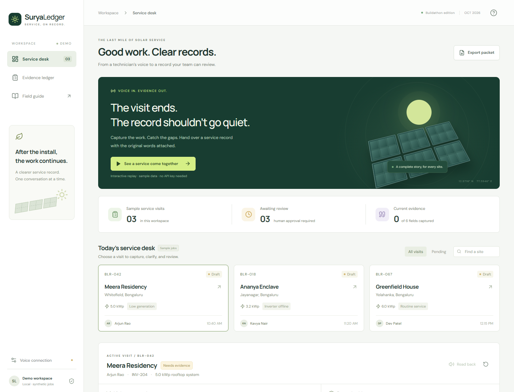
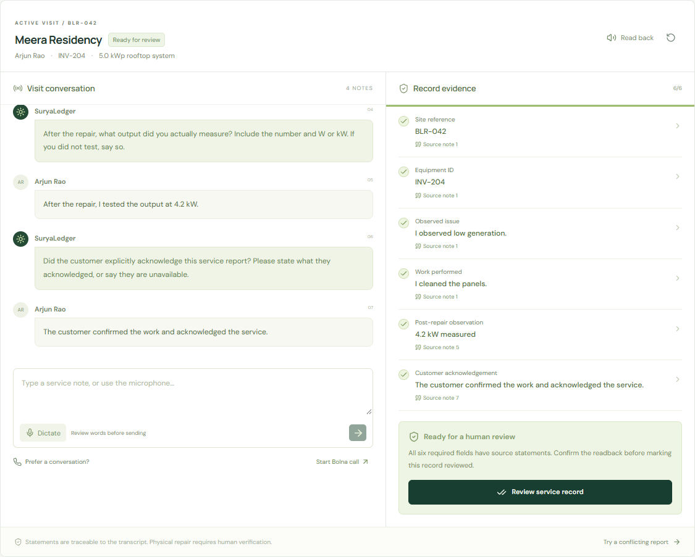
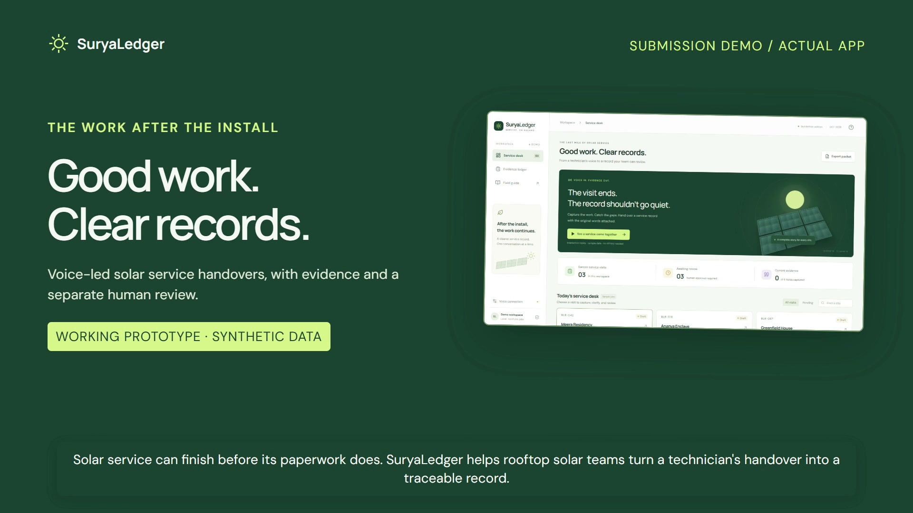
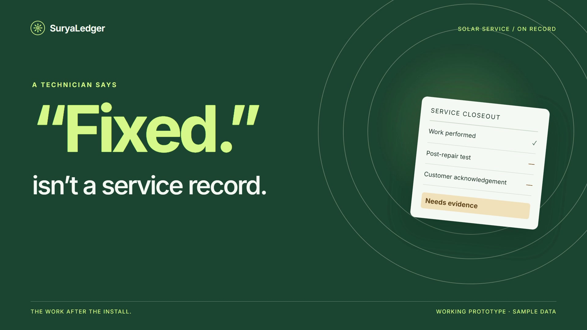
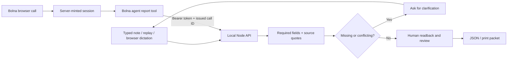

<p align="center"></p>

<h1 align="center">SuryaLedger</h1>
<p align="center"><strong>Service, on record.</strong><br/>A spoken solar-service handover, with source evidence and a separate human review.</p>

<p align="center">React · Node.js · Bolna Web Call · MIT<br/><strong>Working replay prototype · synthetic data · Bolna connection and tool callback observed; full-report validation pending</strong></p>

<p align="center"><a href="https://github.com/Pradhyut21/suryaledger/actions/workflows/ci.yml"></a></p>



A technician says the visit is finished. The service record still needs an equipment ID, the work performed, an observed post-repair output, and customer acknowledgement. SuryaLedger collects that handover in conversation, links supported fields to exact source text, and asks for what is missing. Conflicting statements hold the report until they are explicitly corrected.

This is a focused **rooftop-solar service documentation prototype** built for the Bolna Symphony Buildathon. It is not a repair diagnostic system or a safety certificate. Quotes establish what was submitted, not what physically happened.

## Try it locally

Requires **Node.js 22.12 or newer** and npm. No API key is needed for replay, typed reports, evidence review, or export.

```sh
npm ci
npm run build
npm start
```

Open **http://127.0.0.1:8787**. On Windows, the supplied `START-DEMO.ps1` also installs missing dependencies, builds and starts the app.

The downloadable submission archive also includes a ready-built `dist/`. From that extracted app folder, `node server/index.mjs` starts it directly with no dependency installation. The source repository excludes build artifacts; use the reproducible build commands there.

For development, `npm run dev` starts the API on port 8787 and Vite on **http://127.0.0.1:5173**. Changing `.env` requires a restart. A busy port can be changed with `PORT` for the API; update the development proxy through the same `.env` value.

## The demo in one minute

1. Click **See a service come together**. The clearly labeled replay uses a synthetic site and four technician notes.
2. Notice that “I have not tested it yet” leaves the post-repair field missing. The next note supplies an observed `4.2 kW` result.
3. Click a captured field to inspect its exact source quote. Use **Evidence ledger** to see current, withdrawn and superseded statements.
4. Choose **Review service record**. Read the captured facts, enter a reviewer name, and explicitly confirm review.
5. Export the JSON packet or print the reviewed record. Review is a local workflow action, not authenticated proof of a supervisor's identity.
6. Try **a conflicting report**. A claimed inverter replacement followed by a denial holds the report and shows both source notes.

To resolve the sample action conflict, submit `Correction, I reset the inverter.` Then supply any remaining evidence. A different supported example is `Correction, equipment ID is INV-204.` The parser handles documented patterns; arbitrary phrasing can require a restatement.

## What works

| Capability | Current implementation |
|---|---|
| Report capture | Typed notes, deterministic replay; browser dictation where SpeechRecognition is supported |
| Required evidence | Site, equipment, issue, completed action, explicit post-repair W/kW observation, customer acknowledgement |
| Source tracing | Field value, exact submitted quote, source turn ID and revision history |
| Clarification | Targeted next question for missing information; holds for supported conflicts and assigned-site mismatch |
| Corrections | Explicit corrections retain prior evidence as superseded |
| Review | Readback of captured fields; a separate reviewer confirmation invalidated by a new note |
| Handover | JSON packet with source turns and review; printable service record |
| Draft storage | Browser localStorage; live tool snapshots are bounded, ephemeral server memory |
| Live voice adapter | Official `@bolna/web-call`, server-minted session, token-protected report tool and fresh per-call routing; an account-backed connection and callback have been observed |

The domain engine is **rule-based**, not a general language model. Bolna supplies the optional conversational speech layer. This separation makes the supported gate inspectable; it does not establish broad language coverage or superior accuracy.



## Watch the product demonstration

[](docs/assets/submission-demo.mp4)

[Download the main demonstration](docs/assets/submission-demo.mp4) · [Seven-slide pitch PDF](docs/assets/SuryaLedger-Pitch.pdf) · [Editable PowerPoint](docs/assets/SuryaLedger-Pitch.pptx)

The main film records the **actual app** with synthetic typed notes and a local synthetic narrator. It shows missing evidence, quoted source text, conflicting IDs and correction history, separate human review, and the real JSON export. It does not show a live Bolna call. [Script and captions](docs/DEMO-VIDEO.md).

## Short launch teaser

[](docs/assets/launch.mp4)

The film uses synthetic service data and a reconstruction of the actual app interface. [Download the MP4](docs/assets/launch.mp4). The separate editable HyperFrames project is included in the delivery archive. Music and sound credits are in [VIDEO-CREDITS.md](docs/VIDEO-CREDITS.md).

## Bolna connection

An **account-backed browser WebRTC connection and actual report-tool callback have been observed** with synthetic caller audio. Four bounded synthetic calls were inspected. The best populated five of six fields but included an incorrectly transcribed equipment ID; the latest connected but produced no report callback before the test stopped. No complete spoken handover passed. Spoken-ID normalization fixes pass the text regressions, while live reliability remains unresolved. See [`docs/LIVE-VALIDATION.md`](docs/LIVE-VALIDATION.md) for the failure, fix and exact scope.

The caller audio was locally generated Windows TTS or Kokoro speech fed into a browser media stream, not a physical microphone or a customer. This establishes connection/tool transport, not field speech accuracy. To configure your own account:

1. Copy `.env.example` to `.env` and set `BOLNA_API_KEY`, `BOLNA_AGENT_ID`, and a distinct `BOLNA_TOOL_TOKEN`.
2. Create/configure the agent with [`bolna/system-prompt.md`](bolna/system-prompt.md).
3. Follow [`docs/BOLNA.md`](docs/BOLNA.md) to expose a test HTTPS endpoint and add the report tool. `npm run bolna:config` generates a private, ignored import file after `BOLNA_PUBLIC_BASE_URL` is configured.
4. Restart, use a synthetic job, and complete the documented full-report checks before claiming an end-to-end workflow result.

The app never sends the account API key to the browser. Each call has a fresh routing ID tied server-side to its selected site. Tool text remains model-mediated: quote provenance is to that submitted text, not independently verified against a provider recording. Only a human reviews the draft.

## Architecture



Key implementation: [`server/engine.mjs`](server/engine.mjs), [`server/index.mjs`](server/index.mjs), [`src/main.jsx`](src/main.jsx). The server is stateless for typed analysis; live snapshots are single-user demo state. Do not expose it as a production service without authentication, access controls, durable storage and session/transcript verification.

## Verification

```sh
npm test
npm run evaluate
npm run build
```

As of 22 October 2026: **58 automated tests pass**, **25/25 authored synthetic evaluation cases pass**, and the previously recorded **12/12 browser workflow checks pass**. The evaluation includes negative tests, future intent, uncertain statements, historical/nameplate readings, denied repairs, inconsistent IDs, explicit corrections, spoken-digit identifiers and explicit spoken decimal readings. The HTTP tests cover input validation, request limits, assigned-site mismatch, session minting and tool authorization/correlation. See [`evals/results.json`](evals/results.json), [`docs/VERIFICATION.md`](docs/VERIFICATION.md) and [`docs/LIVE-VALIDATION.md`](docs/LIVE-VALIDATION.md).

These are finite software checks. They are **not** a speech benchmark, field deployment, real-customer accuracy measurement, or claim of protection against arbitrary instructions.

## Research and pitch

- [`docs/RESEARCH.md`](docs/RESEARCH.md): eight-section source-linked brief, five candidate ideas, competitors, six GitHub repositories, five papers, validation and market hypotheses.
- [`docs/PITCH.md`](docs/PITCH.md): 90-second founder script, demo sequence and judge Q&A.
- [`docs/SUBMISSION.md`](docs/SUBMISSION.md): concise application copy and submission checklist.
- [`docs/ROADMAP.md`](docs/ROADMAP.md): what to validate before expanding the prototype.

Voice service reports and field-service software already exist. The research covers Settle, MaintainX, SenseHawk, Raptor Maps and Zoho FSM; it does not claim an uncontested market. The proposition to test is a usable, inspectable closeout workflow for small rooftop installers.

## Repository and publication

The source is published at [Pradhyut21/suryaledger](https://github.com/Pradhyut21/suryaledger) with a reproducible lockfile, tests, CI, evaluation fixtures, license and contribution notes. The main MP4, PDF and editable pitch are included above. A hosted app and competition submission are not claimed; the accepted Drive pitch link must have its public sharing checked separately. Do not put `.env`, `.bolna/` or real customer reports into a public repository.

Clone the public source:

```sh
git clone https://github.com/Pradhyut21/suryaledger.git
cd suryaledger
```

The official [Buildathon](https://www.bolna.ai/symphony/buildathon) lists **31 October 2026** as the submission deadline. Its submission client requires a registered email and a publicly shared Google Drive/Docs or Luma pitch link. The exact deadline time was not published in the inspected material; verify it with the organizer.

## Boundaries

All seeded jobs are synthetic. Browser dictation may use a browser provider's remote speech service and depends on browser permissions/support. The validator supports explicit English and limited Romanized Hindi patterns, with no measured multilingual speech accuracy. Acknowledgement is a technician-reported claim. There is no independent customer signature, photo/sensor verification, immutable audit storage, production authentication, warranty adjudication or electrical guidance.

MIT licensed. Dependencies, bundled fonts and any separately delivered launch-video music retain their own licenses.
